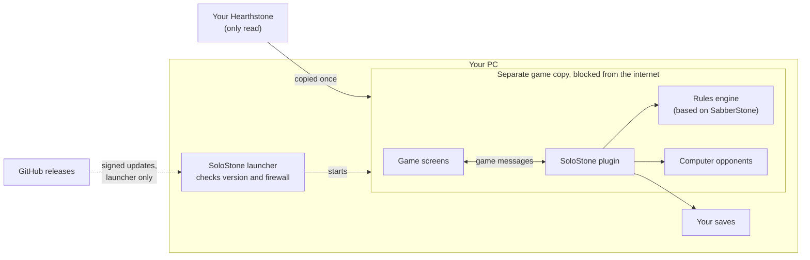

# SoloStone

> [!WARNING]
> **Alpha 0.1.0.** SoloStone is in early playtesting, so bugs and blockers can happen. Feedback is very welcome:
> if anything goes wrong, tell us on [Discord](https://discord.gg/e45QgKHmC2) or open an
> [issue](https://github.com/KeyStarr/SoloStone/issues).

> [!NOTE]
> **From the author.** SoloStone is a one-person hobby project, and the code and docs are in rough shape: so far it
> was built to work, not to be pretty. If people really want to play it, I'll invest more effort in cleaning it up.
> I also have a full-time job and a family, so I'm often exhausted and may reply with delays for now. Thanks for your
> patience.

SoloStone is an unofficial offline single-player mod for Hearthstone®. It requires your own legally obtained Hearthstone client. Not affiliated with, endorsed by, or sponsored by Blizzard Entertainment. Hearthstone is a trademark or registered trademark of Blizzard Entertainment, Inc.

**Play Hearthstone offline, on your own PC, against computer opponents.** You get the game's own screens, ranked and
casual matches, deck building, packs and progress, all kept on your machine.

[Just want to play?](#just-want-to-play) · [How it works](#how-it-works) · [Contributing](#contributing) · [Build from source](docs/BUILDING.md)

## Just want to play?

You need Windows 10 or 11 (64-bit), Hearthstone installed through Battle.net, and about 12.5 GB free.

1. **Quit Battle.net**: right-click its icon in the tray, choose **Quit**. Do this every time before you play.
2. Download **`SoloStone-Setup-0.1.0.exe`** from the [latest release](https://github.com/KeyStarr/SoloStone/releases/latest).
3. Run it. Windows shows a blue **"Windows protected your PC"** page, because the installer has no paid code-signing
   certificate. Click **More info**, then **Run anyway**.
4. Follow the five setup steps. When Windows asks for permission (for the firewall rules), click **Yes**.
5. Start **SoloStone** from the desktop or Start menu shortcut and press **Play**.

Something went wrong? Tell us on [Discord](https://discord.gg/e45QgKHmC2). The full guide is in [INSTALL.md](docs/INSTALL.md).

## What it is

- **A mod for a separate copy of your game.** SoloStone copies the Hearthstone you already have, adds its own files
  to the copy and blocks the copy from the internet. Your normal Hearthstone folder is only read.
- **A local game with computer opponents.** Opponents have their own decks, skill levels and personalities. You climb
  a local ladder, build decks, open packs and earn rewards by playing.
- **One fixed card set.** The first release plays the Standard format as it stood just before the *Reign of the Black
  Empire* expansion (the "Violet Hold meta" in the files). It does not follow later balance changes.

## What it is not

- **Not online.** No server, no matchmaking. SoloStone never logs in anywhere. A local-network multiplayer mode is
  being built ([MULTIPLAYER.md](docs/MULTIPLAYER.md)); it is not playable in the game yet.
- **Not a way to get Hearthstone.** You need the game installed through Battle.net first. SoloStone ships no
  Hearthstone program files, art or sound.
- **Not for sale.** SoloStone takes no money of any kind, from anyone.

The card data file does contain card names and English card text taken from the game, which belong to Blizzard.
[NOTICE](NOTICE) says what is where.

**Rights holders:** if you represent Blizzard Entertainment or another rights holder and are not OK with this project,
or with any part of it, please write to KirillLoves@proton.me. I'll reply promptly and we can talk it through.

## How it works

1. **Install.** The setup copies your Hearthstone into `%LOCALAPPDATA%\SoloStone\client`, adds the mod files and asks
   Windows to block every program in the copy from the internet.
2. **Launch.** The launcher checks your client version and the firewall rules, then starts the copy.
3. **Load.** A standard Unity mod loader ([BepInEx](https://github.com/BepInEx/BepInEx)) loads the SoloStone plugin
   inside the game. The plugin changes the game's code in memory only, each time the game starts. On disk, the copy
   gets the mod files and its own company name, so its settings stay apart from your Hearthstone.
4. **Play.** Where the game would talk to Blizzard's servers, the plugin answers instead:
   - your moves go to a local **rules engine**, based on the open-source
     [SabberStone](https://github.com/HearthSim/SabberStone) simulator;
   - the engine's results come back as the same messages a server would send, so the game's own screens show them;
   - **computer opponents** choose their moves from what a real player could see: no peeking at your hand, no rigged
     draws.
5. **Save.** Your collection, decks, rank and rewards live in saves on your PC (`%LOCALAPPDATA%\SoloStone\saves`).
   Rewards are saved before they are shown, and the saves are backed up, so a crash does not lose or repeat them.

**Safety checks.** SoloStone refuses to start if the firewall rules are missing, if it finds a network connection,
or if your game version is one it can't handle. Your own Hearthstone, your Battle.net
app and your account are never touched.

## What to expect

- **This is an alpha.** It has rough edges and has been tested on few machines.
- **Windows only for now**, tested with Hearthstone client 37.0.0.254477. Steam Deck and Linux are not supported yet.
- **Windows asks for permission once**, to add the firewall rules.
- **Hearthstone updates:**

  | Your client changes by | SoloStone |
  |---|---|
  | a small patch | keeps working, no message |
  | a medium update | shows a warning you can click through |
  | a new major version | waits for a matching SoloStone release; copies already installed keep working |

- **Updates to SoloStone** come only through the launcher, before the game starts, and are checked against a
  signature. You can turn them off. [INSTALL.md](docs/INSTALL.md) lists exactly what connects.
- **Card text** comes from SoloStone's own file, in English, so it can differ from your updated client or the live game.

## Contributing

**For now SoloStone takes issues, not pull requests** ([CONTRIBUTING.md](.github/CONTRIBUTING.md)). If there is real
demand, proper contribution rules, CI and a mod API come next. Until then, the most useful help is:

| You can | How |
|---|---|
| Report a bug | Open an [issue](https://github.com/KeyStarr/SoloStone/issues): your SoloStone and Hearthstone versions, what you did, what you expected, what happened |
| Report a wrong card or rule | Name the card (or its ID), say what it did and what it should do. A link to a source helps |
| Tell us an opponent played badly | Say what it did and what a good player would have done |
| Build it yourself | [BUILDING.md](docs/BUILDING.md). You need your own Hearthstone client as reference libraries |
| Report a security problem | [SECURITY.md](.github/SECURITY.md). Not as a public issue |

Please don't post account details, passwords or tokens, and don't attach game files or card art. Logs can include
your Windows user name: check them first.

Chat: [Discord](https://discord.gg/e45QgKHmC2)

### Not there yet

- **The test suite is not published yet.** The card, rules and match tests stay private for now, so a change you
  make here is not checked by them.
- **There is no mod API or developer mode yet.** If there is demand, it gets designed properly. Until then, a mod is
  a set of patches on top of ours in your own fork. Pull requests are not encouraged yet; open an issue instead.

### Repository layout

| Folder | What is in it |
|---|---|
| `engine/` | The rules engine: a modified SabberStone (AGPL) with the newer card mechanics |
| `plugin/` | The plugin that runs inside the game: game messages, screens, opponents, saves |
| `installer/` | The setup and the launcher (`SoloStone.exe`), with its tests |
| `facts/` | The card data for the fixed card set, one file per meta |
| `data/` | Opponent decks and personalities, card pools, shop, packs and progression data |
| `plugin/Multiplayer/` | The local-network multiplayer core: lobby, run, game sync ([MULTIPLAYER.md](docs/MULTIPLAYER.md)) |
| `tests/`, `tools/` | Tests for the multiplayer core and a terminal table to try it without the game |

Branch and commit naming: [GIT.md](docs/GIT.md).

## Source and licence

The source for every download is in this repository, at that release's tag. [BUILDING.md](docs/BUILDING.md) says how to
build it.

SoloStone's own code is licensed under the GNU AGPL version 3 or later ([LICENSE](LICENSE)), with an additional
permission for its own files ([LICENSE-ADDITIONAL-PERMISSION.md](LICENSE-ADDITIONAL-PERMISSION.md)). The rules engine
is based on SabberStone, which is also AGPL. Other people's work and its licences are listed in [NOTICE](NOTICE).
